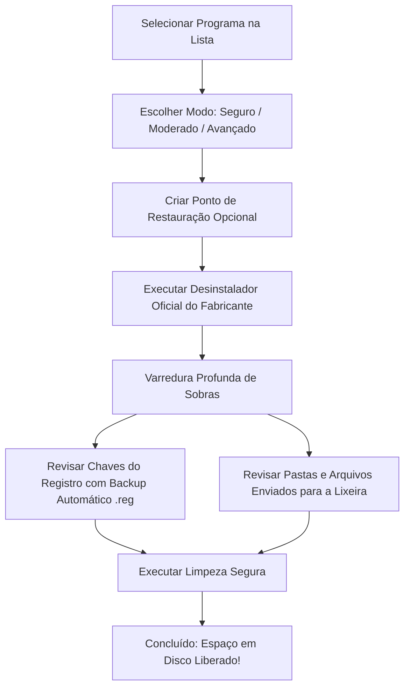

# ⚡ RevoClean Portable

<p align="center">
  
  
  
  
</p>

O **RevoClean Portable** é um desinstalador avançado de código aberto para Windows inspirado no consagrado **Revo Uninstaller**. Ele foi desenvolvido com foco em privacidade, portabilidade e eficiência, sendo capaz de remover completamente programas convencionais e aplicativos modernos da Microsoft Store, além de varrer e eliminar sobras residuais (arquivos órfãos, pastas temporárias e chaves abandonadas do Registro).

---

## ✨ Destaques

- 🚀 **100% Portátil:** Um único arquivo executável (`RevoClean_Portable.exe`), sem instalador, sem rastros e pronto para rodar direto de um pendrive ou pasta local.
- 💻 **Suporte Híbrido Completo:**
  - **Programas Clássicos Desktop (Win32):** Softwares instalados via EXE, MSI ou instaladores personalizados (32-bit e 64-bit).
  - **Aplicativos da Microsoft Store (UWP / AppX / MSIX):** Detecta e desinstala apps modernos como Spotify, WhatsApp, Netflix, Calculadora, etc.
- 🧹 **Varredura Profunda de Sobras (Deep Cleaner):**
  - **Modo Seguro:** Verifica o local original de instalação e as chaves de registro oficiais.
  - **Modo Moderado (Recomendado):** Varre dados de usuário (`AppData`, `LocalAppData`, `ProgramData`), atalhos e chaves de registro relacionadas.
  - **Modo Avançado:** Varredura detalhada em todas as chaves e pastas do sistema.
- ⚡ **Desinstalação Forçada (Force Uninstall):** Permite eliminar programas cujo desinstalador oficial foi corrompido, excluído ou que nem sequer aparecem na lista de programas.
- 🛡️ **Segurança de Nível Empresarial:**
  - **Envio para a Lixeira:** Arquivos e pastas residuais são enviados para a Lixeira do Windows via API nativa (`SHFileOperationW`), nunca deletados permanentemente sem chance de recuperação.
  - **Backup Automático do Registro:** Gera arquivo `.reg` de backup em `%LOCALAPPDATA%\RevoClean_Portable\Backups` antes de apagar qualquer chave.
  - **Pontos de Restauração:** Criação de Pontos de Restauração do Windows com um clique.
  - **Whitelist do Sistema:** Bloqueio estrito para nunca alterar pastas protegidas do Windows (`C:\Windows`, `System32`, raízes de unidade, etc.).
- 🎨 **Interface Moderna:** Construída com CustomTkinter, suporte a tema escuro/claro, ordenação interativa de colunas e busca em tempo real.
- 💾 **Exportação:** Exporta a lista completa de programas instalados para arquivos `.csv` ou `.txt`.

---

## 📸 Como Funciona o Fluxo de Desinstalação



---

## 🚀 Como Usar

### Opção 1: Executável Pronto (Recomendado)
1. Baixe o arquivo **[`RevoClean_Portable.exe`](RevoClean_Portable.exe)** na aba [Releases](../../releases) ou na pasta raiz do repositório.
2. Dê duplo clique para executar.
3. Se o Windows solicitar, autorize a execução como Administrador (necessário para gerenciar pastas em `Program Files` e chaves do Registro).

### Opção 2: Executar a partir do Código-Fonte
Se preferir rodar direto no Python:

1. Clone o repositório:
   ```bash
   git clone https://github.com/seu-usuario/revoclean-portable.git
   cd revoclean-portable
   ```

2. Instale as dependências:
   ```bash
   pip install -r requirements.txt
   ```

3. Inicie o aplicativo:
   ```bash
   python app.py
   ```

---

## 🛠️ Como Compilar o Executável (.exe)

O projeto inclui um script automatizado de compilação utilizando o **PyInstaller**:

```bash
python build.py
```

O script gerará o binário standalone otimizado em:
```
dist/RevoClean_Portable.exe
```

---

## 📂 Estrutura do Repositório

```text
├── app.py                      # Ponto de entrada e configuração de DPI
├── build.py                    # Script de build para PyInstaller
├── requirements.txt            # Dependências Python
├── README.md                   # Este arquivo
├── DOCUMENTATION.md            # Documentação técnica e histórico de arquitetura
├── LICENSE                     # Licença MIT
├── .gitignore                  # Arquivos ignorados pelo Git
└── src/
    ├── config.py               # Configurações, whitelists e exclusões
    ├── system_utils.py         # APIs Win32 (Lixeira, UAC, backups, restauração)
    ├── scanner.py              # Varredura híbrida (Win32 + Store AppX)
    ├── uninstaller_runner.py   # Execução supervisionada de desinstaladores
    ├── deep_cleaner.py         # Motor de varredura profunda de resíduos
    └── ui/
        ├── main_window.py      # Tela principal e listagem
        ├── wizard_dialog.py    # Assistente de desinstalação Revo-style
        └── forced_dialog.py    # Desinstalação forçada
```

---

## 🤝 Contribuição

Contribuições são muito bem-vindas! Se você deseja adicionar novos recursos, corrigir bugs ou aprimorar a interface:

1. Faça um **Fork** do projeto.
2. Crie uma branch para sua funcionalidade:
   ```bash
   git checkout -b feature/minha-melhoria
   ```
3. Commit suas alterações:
   ```bash
   git commit -m "Adiciona suporte a desinstalação em lote"
   ```
4. Envie para o GitHub:
   ```bash
   git push origin feature/minha-melhoria
   ```
5. Abra um **Pull Request**.

---

## 📄 Licença

Este projeto é distribuído sob a licença **MIT**. Consulte o arquivo [LICENSE](LICENSE) para mais detalhes.
